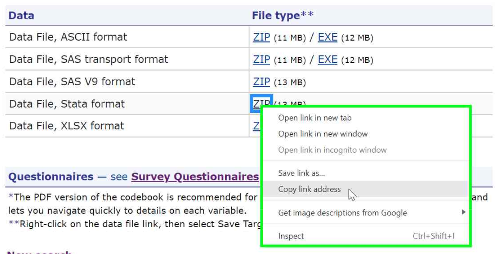

# Analyzing MEPS data using Python <!-- omit in toc -->

- [Installing Python packages](#installing-python-packages)
- [Loading MEPS data](#loading-meps-data)
  - [All data years: Using the `meps` module](#all-data-years-using-the-meps-module)
  - [Data years 2017 and later: SAS V9 and Stata](#data-years-2017-and-later-sas-v9-and-stata)
  - [Data years 1996-2016: SAS XPORT format](#data-years-1996-2016-sas-xport-format)
- [Automating file download](#automating-file-download)
- [Saving Python data (.parquet)](#saving-python-data-parquet)
- [svy package in Python](#svy-package-in-python)
- [Python examples](#python-examples)
  - [Workshop exercises](#workshop-exercises)
  - [Summary tables examples](#summary-tables-examples)


# Installing Python packages

> Note: Python version 3.11 or later is recommended.

To load and analyze MEPS data in Python, additional packages are needed. A package only needs to be installed once per Python environment, typically with `pip` from a terminal (not from within Python). The `import` statements need to be run every time Python is re-started.

The examples in this folder use the [`svy`](https://pypi.org/project/svy/) package for survey analysis and for loading SAS and Stata files. Installing `svy` also installs [`polars`](https://pola.rs), which is used for data manipulation.

```
pip install svy==0.32.1 "polars>=2"
```

The examples were checked with `svy` 0.32.1 and `polars` 2. Until `svy` reaches a stable release, later versions may change its interface, so the version is pinned.

``` python
# Run these every time you re-start Python:
import polars as pl
import svy
```


# Loading MEPS data

For data years 2017 and later (and also for the 2016 Medical Conditions file), .zip files for multiple file formats are available, including ASCII (.dat), SAS V9 (.sas7bdat), Stata (.dta), and Excel (.xlsx). Prior to 2017, ASCII (.dat) and SAS transport (.ssp) files are provided for all datasets.

Different functions are needed for importing these various file formats into Python. The simplest method is to use the `read_meps` function from the [`meps` module](workshop_exercises/meps.py) provided in this folder. For users that prefer not to use the `meps` module, care must be taken to ensure that the correct file format is being imported in accordance with the data year, as detailed in the sections below.

The following table summarizes the recommended functions to load the various file formats into Python:

| File type          | Package   | Function     | Example |
| ---------          | :---:     | :---:        | --------|
| All types          | `meps`    | `read_meps`  | `read_meps(year=2017, type="DV")` |
| SAS V9 (.sas7bdat) | `svy`     | `read_sas`   | `svy.read_sas("C:/MEPS/h206b.sas7bdat")` |
| SAS XPORT (.ssp)   | `svy`     | `read_sas`   | `svy.read_sas("C:/MEPS/h188b.ssp")` |
| SAS CPORT (.ssp)   | (none)    | N/A          | N/A
| Stata (.dta)       | `svy`     | `read_stata` | `svy.read_stata("C:/MEPS/h206b.dta")` |


## All data years: Using the `meps` module

The `meps` module ([meps.py](workshop_exercises/meps.py)) is a Python version of the [`MEPS` R package](https://github.com/e-mitchell/meps_r_pkg). To use it, save `meps.py` in the same folder as your Python program.

The `read_meps` function can then be used to import MEPS data into Python directly from the MEPS website. This function automatically detects the best file format to import based on the specified data year and file.

In the following example, the 2016 (h188b), 2017 (h197b), and 2018 (h206b) Dental Visits files are automatically downloaded from the MEPS website and imported into Python. Either the file name or the year and MEPS data type can be specified:

``` python
from meps import read_meps

dn2016 = read_meps(year=2016, type="DV")
dn2017 = read_meps(year=2017, type="DV")
dn2018 = read_meps(year=2018, type="DV")

# Alternative:
dn2016 = read_meps(file="h188b")
dn2017 = read_meps(file="h197b")
dn2018 = read_meps(file="h206b")
```

Allowable "type" values are: FYC, COND, CLNK, RXLK, RX (prescribed medicines), DV (dental), OM (other medical), IP (inpatient), ER (emergency room), OP (outpatient), OB (office-based), HH (home health), PIT, JOBS, and PRPL.


## Data years 2017 and later: SAS V9 and Stata

For users that prefer not to use the `meps` module, multiple data formats are available for MEPS public use files from data years 2017 and later (and also for the 2016 Medical Conditions file). Due to the fast loading speed and simplicity of code, the <b>Stata data format (.dta)</b> is the recommended file format.

> <b> IMPORTANT! </b> SAS transport (.ssp) versions of most these files were created using the SAS CPORT engine. These CPORT data files cannot be read directly into Python, and alternative file formats must be used instead.

In the following examples, the 2018 Dental Visits files (<b>h206b</b>) has been [downloaded from the MEPS website](https://meps.ahrq.gov/mepsweb/data_stats/download_data_files_detail.jsp?cboPufNumber=HC-206B), unzipped, and saved in the local directory <b>C:/MEPS</b>:

<b> Stata (.dta) files -- recommended</b>
``` python
dn2018 = svy.read_stata("C:/MEPS/h206b.dta")
```

<b>SAS V9 (.sas7bdat) files</b>
``` python
dn2018 = svy.read_sas("C:/MEPS/h206b.sas7bdat")
```


## Data years 1996-2016: SAS XPORT format

For data years prior to 2017, ASCII and SAS transport (XPORT) file formats were released for the MEPS public use files. The <b>SAS transport (.ssp)</b> formats are the recommended file type (excluding the 2016 Medical Conditions file).

These files can be read into Python using the `read_sas` function from the `svy` package, which detects the SAS transport format automatically. In the following example, the SAS XPORT format of the 2016 Dental Visits file (<b>h188b.ssp</b>) has been downloaded from the MEPS website, unzipped, and saved in the local directory <b>C:/MEPS</b>.

```python
dn2016 = svy.read_sas("C:/MEPS/h188b.ssp")
```


# Automating file download

Instead of manually downloading, unzipping, and storing MEPS data files in a local directory, it may be beneficial to automatically download MEPS data directly from the MEPS website. The following code downloads and unzips the 2018 Dental Visits file (h206b), and stores it in a temporary folder (alternatively, the file can be stored permanently by editing the `extract_dir` variable). The file can then be loaded into Python using the appropriate function (e.g. `svy.read_stata` for the Stata file format):
``` python
import tempfile
import urllib.request
import zipfile
from pathlib import Path

import svy

# Download Stata (.dta) zip file
url = "https://meps.ahrq.gov/mepsweb/data_files/pufs/h206b/h206bdta.zip"
zip_file, _ = urllib.request.urlretrieve(url)

# Unzip and save to temporary folder
extract_dir = Path(tempfile.mkdtemp())

# Alternatively, this will save a permanent copy of the file to the local folder "C:/MEPS/Python-downloads"
# extract_dir = Path("C:/MEPS/Python-downloads")

with zipfile.ZipFile(zip_file) as z:
    z.extractall(extract_dir)
    meps_file = extract_dir / z.namelist()[0]

# Read the .dta file into Python
dn2018 = svy.read_stata(meps_file)
```

To download additional files programmatically, replace 'h206b' in the above code with the desired filename (see [meps_files_names.csv](https://github.com/HHS-AHRQ/MEPS/blob/master/Quick_Reference_Guides/meps_file_names.csv) for a list of MEPS file names by data type and year). The full URL of each zip file can be found by right-clicking the 'ZIP' hyperlink on the web page for the data file, selecting 'Copy link address', then pasting into a text editor or code editor.




# Saving Python data (.parquet)

Once the MEPS data has been loaded into Python, it can be saved as a Parquet file (.parquet) for faster loading. In the following code, the 2018 Dental Visits dataset is saved to the C:/ drive (first create the 'MEPS/Python/data' folder if needed):
``` python
dn2018.write_parquet("C:/MEPS/Python/data/dn2018.parquet")
```
This dataset can then be loaded into subsequent Python sessions using the code:
``` python
dn2018 = pl.read_parquet("C:/MEPS/Python/data/dn2018.parquet")
```


# svy package in Python
To analyze MEPS data using Python, the [`svy` package](https://pypi.org/project/svy/) should be used to ensure unbiased estimates. The svy package defines a **survey sample** with information about the sampling procedure, then runs analyses on that sample. Some of the functions in the svy package that are most useful for analyzing MEPS data include:

*   `svy.Design`, `svy.Sample`: define the survey sample
*   `estimation.total`: population totals
*   `estimation.mean`, `estimation.prop`: means and proportions
*   `estimation.median`, `estimation.quantile`: quantiles (e.g. median)
*   `estimation.ratio`: ratio statistics (e.g. percentage of total expenditures)
*   `glm.fit`: generalized linear regression

Estimates for subgroups are requested with the `by` argument (e.g. `by="age_cat"`), and for subpopulations with the `where` argument (e.g. `where=pl.col("TOTEXP18") > 0`). Using `where` instead of filtering the data keeps the full survey design, which is needed for correct standard errors.

To use the svy package, `svy.Design` specifies the primary sampling unit, the strata, and the sampling weights, and `svy.Sample` attaches the design to the data. Setting `singleton="center"` on the design (equivalent to `survey.lonely.psu='adjust'` in R) ensures accurate standard error estimates if a stratum has only one primary sampling unit. Using `singleton=svy.Singleton("center", domains="apply")` applies the same adjustment to strata with only one primary sampling unit within a subpopulation (equivalent to also setting `survey.adjust.domain.lonely=TRUE` in R). Once the survey sample is defined, population estimates can be calculated using the `estimation` functions. As an example, the following code will estimate total dental expenditures in 2018:
``` python
import svy

mepsdsgn = svy.Sample(
    data=dn2018,
    design=svy.Design(psu="VARPSU", stratum="VARSTR", wgt="PERWT18F", singleton="center"),
)

print(mepsdsgn.estimation.total("DVXP18X"))
```

# Python examples

In order to run the example codes, you must download the relevant MEPS files from the MEPS website and save them to your local computer. The codes are written under the assumption that these files are saved in the local directory "C:/MEPS/". However, the programs can be customized to point to an alternate directory by editing the `MEPS_DIR` variable at the top of each program.


## Workshop exercises
The following codes from previous MEPS workshops and webinars are provided in the [workshop_exercises](workshop_exercises) folder:


### 1. National health care expenses <!-- omit in toc -->
[exercise_1a.py](workshop_exercises/exercise_1a.py): National health care expenses by age group, 2016
<br>
[exercise_1b.py](workshop_exercises/exercise_1b.py): National health care expenses by age group, 2018
<br>

### 2. Prescribed medicine purchases <!-- omit in toc -->
[exercise_2a.py](workshop_exercises/exercise_2a.py): Purchases and expenses for narcotic analgesics or narcotic analgesic combos, 2016
<br>
[exercise_2b.py](workshop_exercises/exercise_2b.py): Purchases and expenses for narcotic analgesics or narcotic analgesic combos, 2018
<br>

### 3. Pooling data files <!-- omit in toc -->
[exercise_3a.py](workshop_exercises/exercise_3a.py): Pooling MEPS FYC files, 2015 and 2016: Out-of-pocket expenditures for unisured persons ages 26-30 with high income
<br>
[exercise_3b.py](workshop_exercises/exercise_3b.py):  Pooling longitudinal files, panels 17-19
<br>
[exercise_3c.py](workshop_exercises/exercise_3c.py): Pooling MEPS FYC files, 2017 and 2018: People with joint pain, using JTPAIN31 for 2017 and JTPAIN31_M18 for 2018
<br>
[exercise_3d.py](workshop_exercises/exercise_3d.py): Pooling MEPS FYC files, 2017-2019: People with joint pain, using [Pooled Linkage Variance file](https://meps.ahrq.gov/mepsweb/data_stats/download_data_files_detail.jsp?cboPufNumber=HC-036) for correct standard error calculation (required when pooling before and after 2019)
<br>

### 4. Regression <!-- omit in toc -->
[exercise_4a.py](workshop_exercises/exercise_4a.py): Logistic regression to identify demographic factors associated with receiving a flu shot in 2018 (using SAQ population)
<br>
[exercise_4b.py](workshop_exercises/exercise_4b.py): Logistic regression for persons that delayed medical care because of COVID, 2020
<br>

### 5. Plots <!-- omit in toc -->
[plot_example.py](workshop_exercises/plot_example.py): Code to re-create the data and plot for Figure 1 in [Statistical brief \#491](https://meps.ahrq.gov/data_files/publications/st491/stat491.shtml).

### 6. Linking Medical Conditions and Event Files  <!-- omit in toc -->
[cond_pmed_2020.py](workshop_exercises/cond_pmed_2020.py): Utilization and expenditures for prescribed medicine purchases for hyperlipidemia, 2020
<br>
[cond_mv_2020.py](workshop_exercises/cond_mv_2020.py): Utilization and expenditures for office-based visits for mental health, 2020

## Summary tables examples

The following codes provided in the [summary_tables_examples](summary_tables_examples) folder re-create selected statistics from the [MEPS-HC Data Tools](https://datatools.ahrq.gov/meps-hc):

### Accessibility and Quality of Care  <!-- omit in toc -->

#### Access to Care <!-- omit in toc -->
[care_access_2017.py](summary_tables_examples/care_access_2017.py):
Reasons for difficulty receiving needed care, by poverty status, 2017
<br>
[care_access_2019.py](summary_tables_examples/care_access_2019.py):
Number and percent of people who did not receive treatment because they couldn't afford it, by poverty status, 2019

#### Diabetes Care <!-- omit in toc -->
[care_diabetes_a1c_2016.py](summary_tables_examples/care_diabetes_a1c_2016.py): Adults with diabetes receiving hemoglobin A1c blood test, by race/ethnicity, 2016

#### Quality of Care <!-- omit in toc -->
[care_quality_2016.py](summary_tables_examples/care_quality_2016.py): Ability to schedule a routine appointment, by insurance coverage, 2016


### Medical conditions <!-- omit in toc -->
[cond_expenditures_2015.py](summary_tables_examples/cond_expenditures_2015.py): Utilization and expenditures by medical condition, 2015 -- Conditions defined by collapsed ICD-9/CCS codes
<br>
[cond_expenditures_2018.py](summary_tables_examples/cond_expenditures_2018.py): Utilization and expenditures by medical condition, 2018 -- Conditions defined by collapsed ICD-10/CCSR codes


### Health Insurance <!-- omit in toc -->
[ins_age_2016.py](summary_tables_examples/ins_age_2016.py): Health insurance coverage by age group, 2016


### Prescribed drugs <!-- omit in toc -->
[pmed_prescribed_drug_2016.py](summary_tables_examples/pmed_prescribed_drug_2016.py): Purchases and expenditures by generic drug name, 2016
<br>
[pmed_therapeutic_class_2016.py](summary_tables_examples/pmed_therapeutic_class_2016.py): Purchases and expenditures by Multum therapeutic class, 2016


### Use, expenditures, and population <!-- omit in toc -->
[use_events_2016.py](summary_tables_examples/use_events_2016.py): Number of events and mean expenditure per event, for office-based and outpatient events, by source of payment, 2016
<br>
[use_expenditures_2016.py](summary_tables_examples/use_expenditures_2016.py): Expenditures for office-based and outpatient visits, by source of payment, 2016
<br>
[use_expenditures_2019.py](summary_tables_examples/use_expenditures_2019.py): Mean expenditure per person, by event type and source of payment, 2019.
<br>
[use_race_sex_2016.py](summary_tables_examples/use_race_sex_2016.py): Utilization and expenditures by race and sex, 2016
